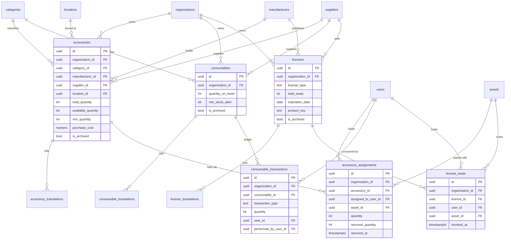
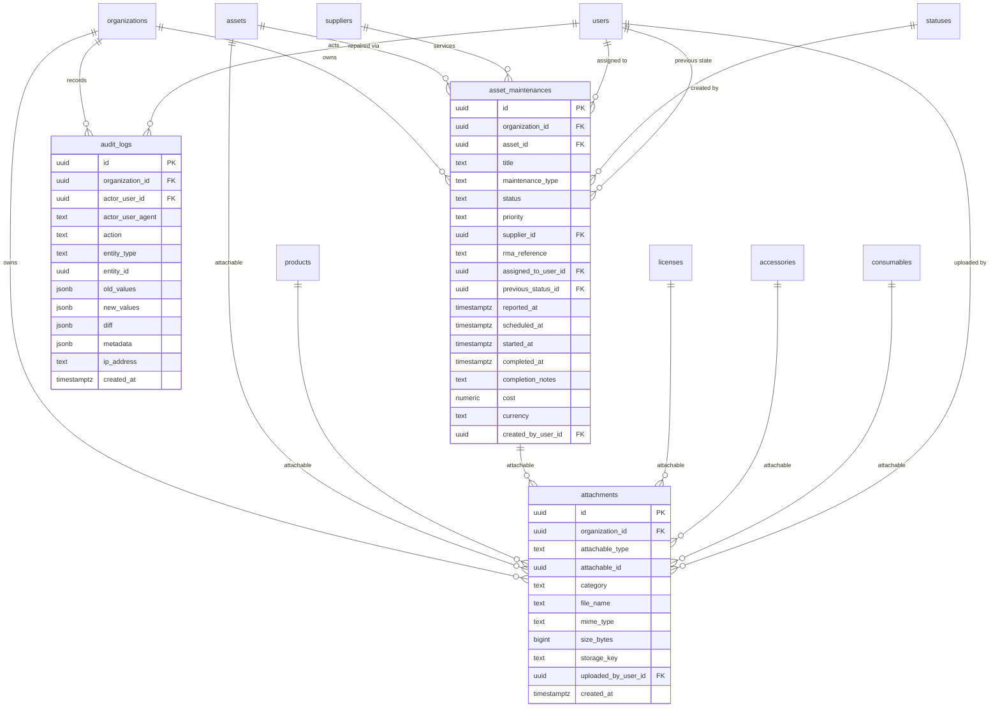
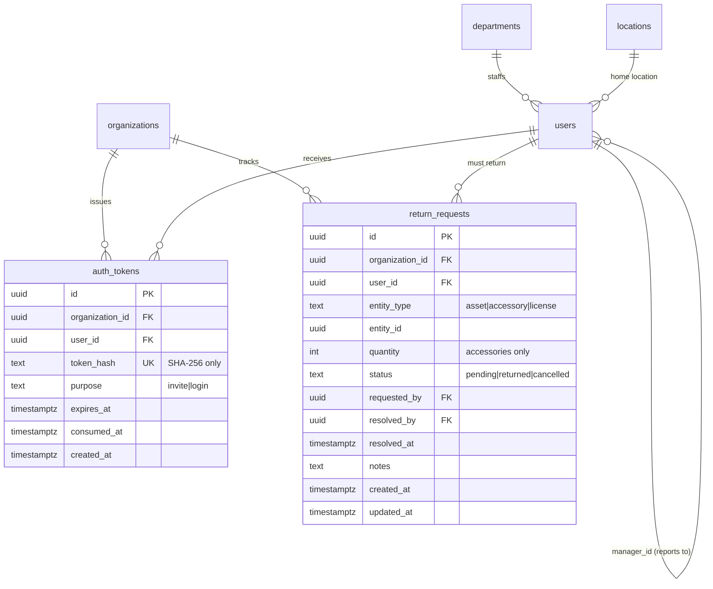
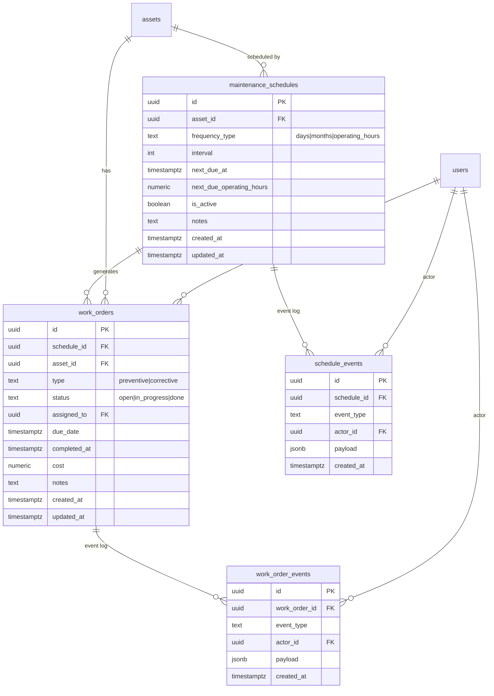

# Database Schema — Mermaid ERD

Source of truth: `migrations/0001_init.sql` … `0007_users_directory_auth.sql`.
Every tenant table carries `organization_id`; all application queries filter on it.

```mermaid
erDiagram
    organizations ||--o{ users : "employs"
    organizations ||--o{ roles : "owns (system roles: NULL)"
    organizations ||--o{ invitations : "issues"
    organizations ||--o{ sessions : "tracks"
    organizations ||--o{ auth_tokens : "issues"
    organizations ||--o{ return_requests : "tracks"
    organizations ||--o{ audit_logs : "records"
    organizations ||--o{ departments : "owns"
    organizations ||--o{ categories : "owns"
    organizations ||--o{ manufacturers : "owns"
    organizations ||--o{ statuses : "owns"
    organizations ||--o{ locations : "owns"
    organizations ||--o{ suppliers : "owns"
    organizations ||--o{ depreciation_models : "owns"
    organizations ||--o{ products : "catalogs"
    organizations ||--o{ assets : "registers"
    organizations ||--o{ asset_assignments : "records"

    permissions ||--o{ role_permissions : "granted via"
    roles ||--o{ role_permissions : "bundles"
    roles ||--o{ user_roles : "assigned as"
    roles ||--o{ invitations : "invites as"
    users ||--o{ user_roles : "holds"
    users ||--o{ sessions : "opens"
    users ||--o{ invitations : "invited by"
    users ||--o{ users : "assigned_by"
    departments ||--o{ users : "staffs"
    users ||--o{ auth_tokens : "receives"
    users ||--o{ return_requests : "must return"
    users ||--o{ audit_logs : "acts"
    users ||--o{ locations : "manages"
    users ||--o{ assets : "holds custody"
    users ||--o{ asset_assignments : "performs"

    departments ||--o{ department_translations : "i18n"
    categories ||--o{ category_translations : "i18n"
    manufacturers ||--o{ manufacturer_translations : "i18n"
    statuses ||--o{ status_translations : "i18n"
    locations ||--o{ location_translations : "i18n"
    suppliers ||--o{ supplier_translations : "i18n"
    depreciation_models ||--o{ depreciation_model_translations : "i18n"
    products ||--o{ product_translations : "i18n"

    categories ||--o{ products : "classifies"
    manufacturers ||--o{ products : "builds"
    depreciation_models ||--o{ products : "amortizes"
    suppliers ||--o{ products : "default source"

    products ||--o{ assets : "instantiates"
    statuses ||--o{ assets : "state"
    departments ||--o{ assets : "owns"
    locations ||--o{ assets : "sited at"
    suppliers ||--o{ assets : "purchased from"

    departments ||--o{ asset_sequences : "counts per product"
    products ||--o{ asset_sequences : "counts per department"
    assets ||--o{ asset_assignments : "custody history"
    statuses ||--o{ asset_assignments : "from/to"
    locations ||--o{ asset_assignments : "from/to"
    departments ||--o{ asset_assignments : "from/to"
    users ||--o{ asset_assignments : "from/to/to-user"

    organizations {
        uuid id PK
        text name
        text slug UK
        timestamptz created_at
        timestamptz updated_at
    }
    permissions {
        uuid id PK
        text code UK
        text description
        timestamptz created_at
    }
    roles {
        uuid id PK
        uuid organization_id FK "NULL = system role"
        text code UK
        text name
        text description
        bool is_system
        timestamptz created_at
        timestamptz updated_at
    }
    role_permissions {
        uuid role_id PK,FK
        uuid permission_id PK,FK
    }
    users {
        uuid id PK
        uuid organization_id FK
        text first_name
        text last_name
        text email "unique per org, lowercase"
        text employee_id "unique per org when set"
        text job_title
        uuid department_id FK
        uuid manager_id FK "self-reference"
        text phone_number
        text avatar_url
        text status "invited|active|suspended|offboarded"
        text preferred_locale "'en'|'fr'|'ar'"
        text password_hash "NULL until setup"
        text auth_provider
        timestamptz email_verified_at
        timestamptz last_login_at
        uuid location_id FK "home location"
        timestamptz deleted_at "soft delete"
        timestamptz created_at
        timestamptz updated_at
    }
    user_roles {
        uuid id PK
        uuid organization_id FK
        uuid user_id FK
        uuid role_id FK
        uuid assigned_by FK
        timestamptz assigned_at
    }
    invitations {
        uuid id PK
        uuid organization_id FK
        text email
        text phone_number
        uuid role_id FK
        text token_hash UK
        uuid invited_by FK
        text status "pending|accepted|expired|revoked"
        timestamptz expires_at
        timestamptz accepted_at
        timestamptz created_at
    }
    sessions {
        uuid id PK
        uuid user_id FK
        uuid organization_id FK
        text token_hash UK
        text ip_address
        text user_agent
        timestamptz expires_at
        timestamptz revoked_at
        timestamptz created_at
    }
    auth_tokens {
        uuid id PK
        uuid organization_id FK
        uuid user_id FK
        text token_hash UK "SHA-256 only"
        text purpose "invite|login"
        timestamptz expires_at
        timestamptz consumed_at
        timestamptz created_at
    }
    return_requests {
        uuid id PK
        uuid organization_id FK
        uuid user_id FK
        text entity_type "asset|accessory|license"
        uuid entity_id
        int quantity "accessories only"
        text status "pending|returned|cancelled"
        uuid requested_by FK
        uuid resolved_by FK
        timestamptz resolved_at
        text notes
        timestamptz created_at
        timestamptz updated_at
    }
    audit_logs {
        uuid id PK
        uuid organization_id FK "nullable"
        uuid actor_user_id FK "nullable"
        text action
        text entity_type
        uuid entity_id
        jsonb metadata
        text ip_address
        timestamptz created_at
    }
    departments {
        uuid id PK
        uuid organization_id FK
        text code UK "1-8 A-Z0-9"
        text email
        text phone_number
        timestamptz created_at
        timestamptz updated_at
    }
    department_translations {
        uuid id PK
        uuid department_id FK
        text locale "en|fr|ar"
        text name
    }
    categories {
        uuid id PK
        uuid organization_id FK
        text code UK "1-8 A-Z0-9"
        text category_type "accessory|asset|consumable|component"
        bool skip_checkout_confirmation_emails
        text icon_url
        timestamptz created_at
        timestamptz updated_at
    }
    category_translations {
        uuid id PK
        uuid category_id FK
        text locale
        text name
    }
    manufacturers {
        uuid id PK
        uuid organization_id FK
        text url
        text support_url
        text support_phone
        text support_email
        text notes
        text logo_url
        timestamptz created_at
        timestamptz updated_at
    }
    manufacturer_translations {
        uuid id PK
        uuid manufacturer_id FK
        text locale
        text name
    }
    statuses {
        uuid id PK
        uuid organization_id FK
        text code UK "lowercase machine key"
        text status_type "deployable|deployed|undeployable|pending|archived"
        text color_code "#RRGGBB"
        bool show_in_nav
        text notes
        timestamptz created_at
        timestamptz updated_at
    }
    status_translations {
        uuid id PK
        uuid status_id FK
        text locale
        text name
    }
    locations {
        uuid id PK
        uuid organization_id FK
        text code UK "1-16 A-Z0-9-"
        uuid parent_id FK "self, RESTRICT"
        text location_type "site|building|floor|room|shelf"
        text address_line1
        text address_line2
        text city
        text state_region
        text postal_code
        text country_code "ISO 3166-1 alpha-2"
        float latitude
        float longitude
        text phone_number
        text email
        uuid manager_user_id FK
        text notes
        bool is_active
        timestamptz created_at
        timestamptz updated_at
    }
    location_translations {
        uuid id PK
        uuid location_id FK
        text locale
        text name
    }
    suppliers {
        uuid id PK
        uuid organization_id FK
        text contact_name
        text email
        text phone_number
        text address
        text url
        text notes
        timestamptz created_at
        timestamptz updated_at
    }
    supplier_translations {
        uuid id PK
        uuid supplier_id FK
        text locale
        text name
    }
    depreciation_models {
        uuid id PK
        uuid organization_id FK
        int months "> 0"
        numeric floor_value ">= 0"
        text notes
        timestamptz created_at
        timestamptz updated_at
    }
    depreciation_model_translations {
        uuid id PK
        uuid depreciation_model_id FK
        text locale
        text name
    }
    products {
        uuid id PK
        uuid organization_id FK
        text code UK "1-8 A-Z0-9"
        uuid category_id FK
        uuid manufacturer_id FK
        uuid depreciation_model_id FK
        text model_code
        text eol_type "fixed_date|months_from_purchase|months_from_warranty|individual"
        date eol_date
        numeric default_purchase_cost
        text default_currency "ISO 4217"
        uuid default_supplier_id FK
        int min_quantity
        text chip
        text operating_system
        text notes
        jsonb custom_fields_json
        jsonb specs_json
        bool is_archived
        text image_url
        timestamptz created_at
        timestamptz updated_at
    }
    product_translations {
        uuid id PK
        uuid product_id FK
        text locale
        text name
    }
    assets {
        uuid id PK
        uuid organization_id FK
        text asset_tag "unique per org"
        uuid product_id FK
        uuid status_id FK
        uuid supplier_id FK
        uuid location_id FK
        uuid department_id FK
        uuid assigned_user_id FK
        text name
        text serial_number "unique per org, case-insensitive"
        date warranty_date
        text order_number
        date purchase_date
        numeric purchase_cost
        text currency
        timestamptz schedule_audit "next audit"
        text notes
        text image_url
        text imei_1 "unique per org"
        text imei_2
        bool mdm_enrolled
        timestamptz created_at
        timestamptz updated_at
    }
    asset_sequences {
        uuid organization_id PK,FK
        uuid department_id PK,FK
        uuid product_id PK,FK
        int last_value
    }
    asset_assignments {
        uuid id PK
        uuid organization_id FK
        uuid asset_id FK
        text action "assign|return|transfer"
        uuid assigned_to_user_id FK
        uuid from_user_id FK
        uuid from_location_id FK
        uuid to_location_id FK
        uuid from_department_id FK
        uuid to_department_id FK
        uuid from_status_id FK
        uuid to_status_id FK
        text notes
        uuid performed_by_user_id FK
        timestamptz created_at
    }
```

## Relationship rules

- `assets.department_id` + `products.id` own a row in `asset_sequences`; the
  counter produces `DEPT.CAT.PROD.NNNN` asset tags.
- Deleting lookups is `RESTRICT`ed while referenced (products→category,
  assets→product/status/department, locations→parent).
- `asset_assignments` is append-only; it never updates existing rows.
- `audit_logs` is append-only and is written in the same transaction as the
  custody mutation it describes.

## Milestone 3 — inventory pillars

## Milestone 4 — maintenance, attachments, audit explorer

Relationship rules (Milestone 4):

- `attachments` is polymorphic: `(attachable_type, attachable_id)` points at one
  of `asset|product|maintenance|license|accessory|consumable`. The pair is
  verified inside the organization before the row is written; there is no FK.
- `asset_maintenances` allows at most one `open`/`in_progress` ticket per asset
  (partial unique index), and `previous_status_id` records the status to
  restore on completion/cancel.
- `audit_logs` remains append-only; `old_values`, `new_values` and `diff` are
  filled by the `audit_row_change()` trigger on every tracked table.

## Milestone 5 — user directory & email-first auth

Migration: `0007_users_directory_auth.sql`.

Relationship rules (Milestone 5):

- `users.manager_id` is a self-FK (`ON DELETE SET NULL`); cycles and
  self-management are rejected in `modules/users/repo.rs`.
- `users.department_id` and `users.location_id` are optional; soft-deleted users
  (`deleted_at IS NOT NULL`) are excluded from lookups and authentication.
- `auth_tokens` stores only SHA-256 hashes. A partial unique index allows one
  live token per `(organization_id, user_id, purpose)`; issuing a new one
  replaces the previous live row.
- `return_requests` is the offboarding worklist: one pending row per
  `(organization_id, entity_type, entity_id)`, created by offboarding for
  assets in custody, open accessory assignments and live license seats.
- Permissions added: `users.create`, `users.delete`, `users.import`,
  `users.offboard`; system role `employee` (read-only directory access).

## Milestone 6 — schedule-driven work orders

Migration: `20260101000008_maintenance_schedules_work_orders.sql`.

Relationship rules (Milestone 6):

- Both new logs are append-only; a DB trigger raises on `UPDATE`/`DELETE`.
- The daily scheduler creates one preventive work order per due window, guarded
  by the partial unique index on `(schedule_id, due_date)`.
- `days`/`months` advance `next_due_at`; `operating_hours` advances
  `next_due_operating_hours` against `assets.current_operating_hours`.
- `DELETE /maintenance-schedules/{id}` only sets `is_active = false` and writes a
  `schedule_deactivated` event.
