# Database Schema — Mermaid ERD

Source of truth: `migrations/0001_init.sql`, `0002_seed_rbac.sql`,
`0003_core_lookups_assets.sql`. Every tenant table carries `organization_id`;
all application queries filter on it.

```mermaid
erDiagram
    organizations ||--o{ users : "employs"
    organizations ||--o{ roles : "owns (system roles: NULL)"
    organizations ||--o{ invitations : "issues"
    organizations ||--o{ sessions : "tracks"
    organizations ||--o{ audit_logs : "records"
    organizations ||--o{ departments : "owns"
    organizations ||--o{ categories : "owns"
    organizations ||--o{ manufacturers : "owns"
    organizations ||--o{ statuses : "owns"
    organizations ||--o{ locations : "owns"
    organizations ||--o{ suppliers : "owns"
    organizations ||--o{ depreciation_models : "owns"
    organizations ||--o{ products : "catalogs"
    organizations ||--o{ assets : "registers"
    organizations ||--o{ asset_assignments : "records"

    permissions ||--o{ role_permissions : "granted via"
    roles ||--o{ role_permissions : "bundles"
    roles ||--o{ user_roles : "assigned as"
    roles ||--o{ invitations : "invites as"
    users ||--o{ user_roles : "holds"
    users ||--o{ sessions : "opens"
    users ||--o{ invitations : "invited by"
    users ||--o{ users : "assigned_by"
    users ||--o{ audit_logs : "acts"
    users ||--o{ locations : "manages"
    users ||--o{ assets : "holds custody"
    users ||--o{ asset_assignments : "performs"

    departments ||--o{ department_translations : "i18n"
    categories ||--o{ category_translations : "i18n"
    manufacturers ||--o{ manufacturer_translations : "i18n"
    statuses ||--o{ status_translations : "i18n"
    locations ||--o{ location_translations : "i18n"
    suppliers ||--o{ supplier_translations : "i18n"
    depreciation_models ||--o{ depreciation_model_translations : "i18n"
    products ||--o{ product_translations : "i18n"

    categories ||--o{ products : "classifies"
    manufacturers ||--o{ products : "builds"
    depreciation_models ||--o{ products : "amortizes"
    suppliers ||--o{ products : "default source"

    products ||--o{ assets : "instantiates"
    statuses ||--o{ assets : "state"
    departments ||--o{ assets : "owns"
    locations ||--o{ assets : "sited at"
    suppliers ||--o{ assets : "purchased from"

    departments ||--o{ asset_sequences : "counts per product"
    products ||--o{ asset_sequences : "counts per department"
    assets ||--o{ asset_assignments : "custody history"
    statuses ||--o{ asset_assignments : "from/to"
    locations ||--o{ asset_assignments : "from/to"
    departments ||--o{ asset_assignments : "from/to"
    users ||--o{ asset_assignments : "from/to/to-user"

    organizations {
        uuid id PK
        text name
        text slug UK
        timestamptz created_at
        timestamptz updated_at
    }
    permissions {
        uuid id PK
        text code UK
        text description
        timestamptz created_at
    }
    roles {
        uuid id PK
        uuid organization_id FK "NULL = system role"
        text code UK
        text name
        text description
        bool is_system
        timestamptz created_at
        timestamptz updated_at
    }
    role_permissions {
        uuid role_id PK,FK
        uuid permission_id PK,FK
    }
    users {
        uuid id PK
        uuid organization_id FK
        text first_name
        text last_name
        text email "unique per org, lowercase"
        text phone_number
        text avatar_url
        text status "invited|active|suspended"
        text preferred_locale "'en' default"
        text password_hash
        text auth_provider
        timestamptz last_login_at
        uuid location_id FK "home location"
        timestamptz created_at
        timestamptz updated_at
    }
    user_roles {
        uuid id PK
        uuid organization_id FK
        uuid user_id FK
        uuid role_id FK
        uuid assigned_by FK
        timestamptz assigned_at
    }
    invitations {
        uuid id PK
        uuid organization_id FK
        text email
        text phone_number
        uuid role_id FK
        text token_hash UK
        uuid invited_by FK
        text status "pending|accepted|expired|revoked"
        timestamptz expires_at
        timestamptz accepted_at
        timestamptz created_at
    }
    sessions {
        uuid id PK
        uuid user_id FK
        uuid organization_id FK
        text token_hash UK
        text ip_address
        text user_agent
        timestamptz expires_at
        timestamptz revoked_at
        timestamptz created_at
    }
    audit_logs {
        uuid id PK
        uuid organization_id FK "nullable"
        uuid actor_user_id FK "nullable"
        text action
        text entity_type
        uuid entity_id
        jsonb metadata
        text ip_address
        timestamptz created_at
    }
    departments {
        uuid id PK
        uuid organization_id FK
        text code UK "1-8 A-Z0-9"
        text email
        text phone_number
        timestamptz created_at
        timestamptz updated_at
    }
    department_translations {
        uuid id PK
        uuid department_id FK
        text locale "en|fr|ar"
        text name
    }
    categories {
        uuid id PK
        uuid organization_id FK
        text code UK "1-8 A-Z0-9"
        text category_type "accessory|asset|consumable|component"
        bool skip_checkout_confirmation_emails
        text icon_url
        timestamptz created_at
        timestamptz updated_at
    }
    category_translations {
        uuid id PK
        uuid category_id FK
        text locale
        text name
    }
    manufacturers {
        uuid id PK
        uuid organization_id FK
        text url
        text support_url
        text support_phone
        text support_email
        text notes
        text logo_url
        timestamptz created_at
        timestamptz updated_at
    }
    manufacturer_translations {
        uuid id PK
        uuid manufacturer_id FK
        text locale
        text name
    }
    statuses {
        uuid id PK
        uuid organization_id FK
        text code UK "lowercase machine key"
        text status_type "deployable|deployed|undeployable|pending|archived"
        text color_code "#RRGGBB"
        bool show_in_nav
        text notes
        timestamptz created_at
        timestamptz updated_at
    }
    status_translations {
        uuid id PK
        uuid status_id FK
        text locale
        text name
    }
    locations {
        uuid id PK
        uuid organization_id FK
        text code UK "1-16 A-Z0-9-"
        uuid parent_id FK "self, RESTRICT"
        text location_type "site|building|floor|room|shelf"
        text address_line1
        text address_line2
        text city
        text state_region
        text postal_code
        text country_code "ISO 3166-1 alpha-2"
        float latitude
        float longitude
        text phone_number
        text email
        uuid manager_user_id FK
        text notes
        bool is_active
        timestamptz created_at
        timestamptz updated_at
    }
    location_translations {
        uuid id PK
        uuid location_id FK
        text locale
        text name
    }
    suppliers {
        uuid id PK
        uuid organization_id FK
        text contact_name
        text email
        text phone_number
        text address
        text url
        text notes
        timestamptz created_at
        timestamptz updated_at
    }
    supplier_translations {
        uuid id PK
        uuid supplier_id FK
        text locale
        text name
    }
    depreciation_models {
        uuid id PK
        uuid organization_id FK
        int months "> 0"
        numeric floor_value ">= 0"
        text notes
        timestamptz created_at
        timestamptz updated_at
    }
    depreciation_model_translations {
        uuid id PK
        uuid depreciation_model_id FK
        text locale
        text name
    }
    products {
        uuid id PK
        uuid organization_id FK
        text code UK "1-8 A-Z0-9"
        uuid category_id FK
        uuid manufacturer_id FK
        uuid depreciation_model_id FK
        text model_code
        text eol_type "fixed_date|months_from_purchase|months_from_warranty|individual"
        date eol_date
        numeric default_purchase_cost
        text default_currency "ISO 4217"
        uuid default_supplier_id FK
        int min_quantity
        text chip
        text operating_system
        text notes
        jsonb custom_fields_json
        jsonb specs_json
        bool is_archived
        text image_url
        timestamptz created_at
        timestamptz updated_at
    }
    product_translations {
        uuid id PK
        uuid product_id FK
        text locale
        text name
    }
    assets {
        uuid id PK
        uuid organization_id FK
        text asset_tag "unique per org"
        uuid product_id FK
        uuid status_id FK
        uuid supplier_id FK
        uuid location_id FK
        uuid department_id FK
        uuid assigned_user_id FK
        text name
        text serial_number "unique per org, case-insensitive"
        date warranty_date
        text order_number
        date purchase_date
        numeric purchase_cost
        text currency
        timestamptz schedule_audit "next audit"
        text notes
        text image_url
        text imei_1 "unique per org"
        text imei_2
        bool mdm_enrolled
        timestamptz created_at
        timestamptz updated_at
    }
    asset_sequences {
        uuid organization_id PK,FK
        uuid department_id PK,FK
        uuid product_id PK,FK
        int last_value
    }
    asset_assignments {
        uuid id PK
        uuid organization_id FK
        uuid asset_id FK
        text action "assign|return|transfer"
        uuid assigned_to_user_id FK
        uuid from_user_id FK
        uuid from_location_id FK
        uuid to_location_id FK
        uuid from_department_id FK
        uuid to_department_id FK
        uuid from_status_id FK
        uuid to_status_id FK
        text notes
        uuid performed_by_user_id FK
        timestamptz created_at
    }
```

## Relationship rules

- `assets.department_id` + `products.id` own a row in `asset_sequences`; the
  counter produces `DEPT.CAT.PROD.NNNN` asset tags.
- Deleting lookups is `RESTRICT`ed while referenced (products→category,
  assets→product/status/department, locations→parent).
- `asset_assignments` is append-only; it never updates existing rows.
- `audit_logs` is append-only and is written in the same transaction as the
  custody mutation it describes.

## Milestone 3 — inventory pillars

