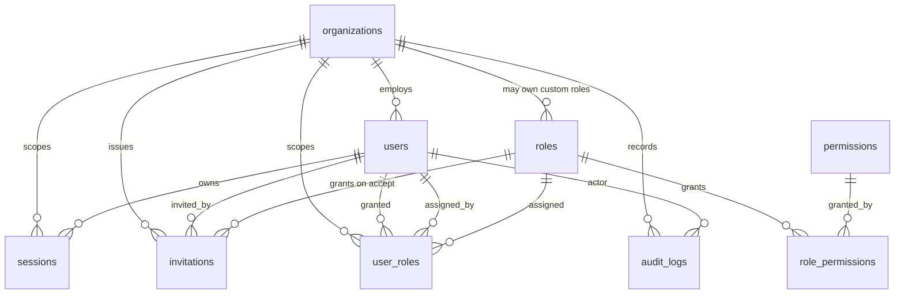

# Database schema

PostgreSQL 17. All primary keys are `uuid` with `gen_random_uuid()`. All
timestamps are `timestamptz`.

## ERD

## Tables

### `organizations`

| Column | Type | Constraints |
| --- | --- | --- |
| id | uuid | PK, default `gen_random_uuid()` |
| name | text | not null |
| slug | text | not null, unique |
| created_at | timestamptz | not null, default `now()` |
| updated_at | timestamptz | not null, default `now()` |

Indexes: `organizations_slug_key` (unique).

### `permissions`

| Column | Type | Constraints |
| --- | --- | --- |
| id | uuid | PK |
| code | text | not null, unique (`resource.action`) |
| description | text | not null |
| created_at | timestamptz | not null |

### `roles`

| Column | Type | Constraints |
| --- | --- | --- |
| id | uuid | PK |
| organization_id | uuid | nullable, FK → `organizations(id)` ON DELETE CASCADE; `NULL` = system role |
| code | text | not null, unique |
| name | text | not null |
| description | text | nullable |
| is_system | boolean | not null, default false |
| created_at / updated_at | timestamptz | not null |

Indexes: `roles_organization_id_idx`.

### `role_permissions`

| Column | Type | Constraints |
| --- | --- | --- |
| role_id | uuid | FK → `roles(id)` ON DELETE CASCADE |
| permission_id | uuid | FK → `permissions(id)` ON DELETE CASCADE |

Primary key: `(role_id, permission_id)`.

### `users`

| Column | Type | Constraints |
| --- | --- | --- |
| id | uuid | PK |
| organization_id | uuid | not null, FK → `organizations(id)` ON DELETE CASCADE |
| first_name | text | not null, default `''` |
| last_name | text | not null, default `''` |
| email | text | not null, lower-case enforced (`users_email_lowercase`) |
| phone_number | text | nullable |
| avatar_url | text | nullable |
| status | text | not null, default `invited`; `invited` \| `active` \| `suspended` |
| preferred_locale | text | not null, default `en` |
| password_hash | text | nullable (null for federated accounts) |
| auth_provider | text | not null, default `local` |
| last_login_at | timestamptz | nullable |
| created_at / updated_at | timestamptz | not null |

Indexes:
- `users_organization_id_idx`
- `users_organization_email_key` unique `(organization_id, email)` — same email may exist in two tenants.

### `user_roles`

| Column | Type | Constraints |
| --- | --- | --- |
| id | uuid | PK |
| organization_id | uuid | not null, FK → `organizations(id)` ON DELETE CASCADE |
| user_id | uuid | not null, FK → `users(id)` ON DELETE CASCADE |
| role_id | uuid | not null, FK → `roles(id)` ON DELETE RESTRICT |
| assigned_by | uuid | nullable, FK → `users(id)` ON DELETE SET NULL |
| assigned_at | timestamptz | not null, default `now()` |

Indexes: unique `(organization_id, user_id, role_id)`; `user_roles_organization_id_idx`; `user_roles_user_id_idx`.

### `invitations`

| Column | Type | Constraints |
| --- | --- | --- |
| id | uuid | PK |
| organization_id | uuid | not null, FK → `organizations(id)` ON DELETE CASCADE |
| email | text | not null, lower-case |
| phone_number | text | nullable |
| role_id | uuid | not null, FK → `roles(id)` ON DELETE RESTRICT |
| token_hash | text | not null, unique (SHA-256 hex) |
| invited_by | uuid | nullable, FK → `users(id)` ON DELETE SET NULL |
| status | text | not null, default `pending`; `pending` \| `accepted` \| `expired` \| `revoked` |
| expires_at | timestamptz | not null |
| accepted_at | timestamptz | nullable |
| created_at | timestamptz | not null |

Indexes:
- `invitations_organization_id_idx`
- `invitations_email_idx` `(organization_id, email)`
- `invitations_one_pending_per_email_idx` — **partial unique** on
  `(organization_id, email) WHERE status = 'pending'`: at most one live invite per
  email per tenant, enforced by the database.

### `sessions`

| Column | Type | Constraints |
| --- | --- | --- |
| id | uuid | PK |
| user_id | uuid | not null, FK → `users(id)` ON DELETE CASCADE |
| organization_id | uuid | not null, FK → `organizations(id)` ON DELETE CASCADE |
| token_hash | text | not null, unique (SHA-256 hex) |
| ip_address | text | nullable |
| user_agent | text | nullable |
| expires_at | timestamptz | not null |
| revoked_at | timestamptz | nullable |
| created_at | timestamptz | not null |

Indexes: `sessions_user_id_idx`, `sessions_organization_id_idx`.

### `audit_logs`

| Column | Type | Constraints |
| --- | --- | --- |
| id | uuid | PK |
| organization_id | uuid | nullable, FK → `organizations(id)` ON DELETE SET NULL |
| actor_user_id | uuid | nullable, FK → `users(id)` ON DELETE SET NULL |
| action | text | not null (e.g. `auth.login`, `invitation.accepted`) |
| entity_type | text | not null |
| entity_id | uuid | nullable |
| metadata | jsonb | not null, default `{}` |
| ip_address | text | nullable |
| created_at | timestamptz | not null, default `now()` |

Indexes: `(organization_id, created_at DESC)`, `action`.

Append-only by convention: no `UPDATE`/`DELETE` statements exist in the codebase.

## Seeded RBAC data

`migrations/20260101000002_seed_rbac.sql` inserts the 13 permissions and the four
system roles (`admin`, `manager`, `technician`, `viewer`) with their grants. See
[rbac.md](./rbac.md).

## Audit events written in Milestone 1

| Action | When |
| --- | --- |
| `organization.bootstrapped` | bootstrap CLI |
| `auth.login` | successful login |
| `auth.login_failed` | unknown user or bad password / inactive account |
| `auth.logout` | logout |
| `invitation.created` | admin creates an invite |
| `invitation.revoked` | admin revokes a pending invite |
| `invitation.accepted` | invitee consumes the token |
| `session.revoked` | one session revoked |
| `session.revoked_all` | forced logout |
| `user.status_changed` | suspend / reactivate |
| `tenant.cross_access_denied` | a session id belonging to another tenant was probed |
